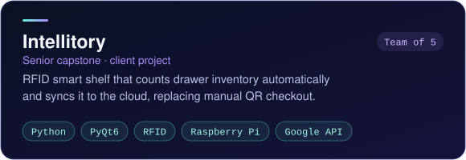
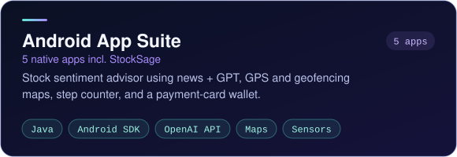
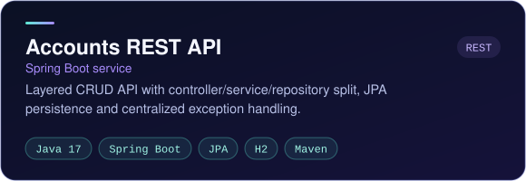
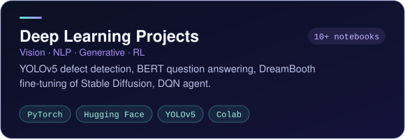
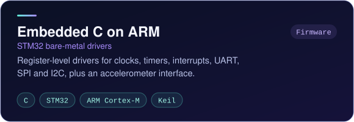
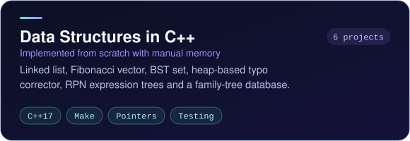

  

  
  
  

 

## About me

I'm a software engineer at **Amazon** in San Diego, with a Computer Engineering degree from **UC Santa Barbara**. I like work that sits between the code and the people using it: understanding the problem, building the tool, and shipping it to the teams who rely on it.

- 🤖 Built an **LLM ticket-resolution agent on AWS Bedrock**, now used by **500+ engineers**, validated at ~95% accuracy on historical tickets
- ⚙️ Designed and launched a **self-service workflow (UI + API)** that replaced manual on-call lookups, saving the team ~10 hours a week
- 📡 Led the software side of an **RFID smart-inventory system** for a medical-device client as my senior capstone
- 🌍 Fluent in English, French, Spanish and Arabic

 

## Featured projects

<table>
  <tr>
    <td width="50%"></td>
    <td width="50%"></td>
  </tr>
  <tr>
    <td width="50%"></td>
    <td width="50%"></td>
  </tr>
  <tr>
    <td width="50%"></td>
    <td width="50%"></td>
  </tr>
</table>

 

## Tech stack

  <b>Languages</b> 
  

  <b>Cloud &amp; backend</b> 
  

  <b>Frontend, mobile &amp; ML</b> 
  

 

## Experience

| | Role | Highlights |
|:--|:--|:--|
| **Amazon** | Software Development Engineer | Bedrock LLM agent, self-service app-management workflow, APIs with unit and integration tests |
| **Alfa Telecom** | iOS Developer Intern | Card-based prepaid recharge in the app, replacing physical top-up cards |
| **SLTWTR** | QA Engineering Intern | Weekly client meetings, turned client needs into QA and engineering tickets |
| **JobDiva** | Software Engineer Intern | Recruiting pipeline features, recruiter dashboards and reporting |
| **UC Santa Barbara** | B.S. Computer Engineering | RFID capstone, ML/AI, embedded systems, mobile development |

 

  Always happy to talk about cloud, AI agents, or a good project. Reach out on <a href="https://www.linkedin.com/in/tamerralphtamer/">LinkedIn</a> or <a href="mailto:tamertamer1683@gmail.com">email</a>.

